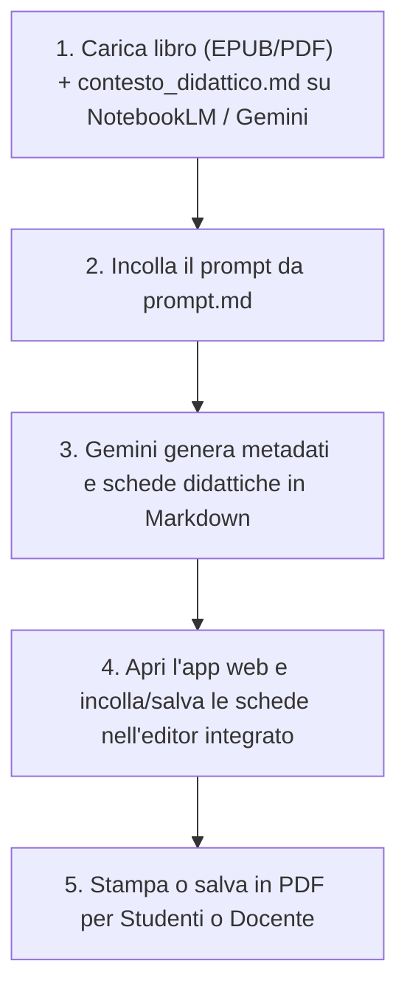

# 📚 Piattaforma Didattica Universale: Analisi Romanzo & Generatore Schede

Una piattaforma modulare, autonoma e universale ideata per docenti della **Scuola Secondaria di Primo Grado**.  
Il sistema consente di prendere un qualsiasi libro o romanzo per ragazzi in formato **EPUB**, estrarne automaticamente il testo pulito, suddividerlo pedagogicamente in blocchi narrativi coerenti, generare schede didattiche complete ad alta valenza formativa e impaginarle tramite un'**applicazione web interattiva** pronta per la stampa in PDF.

---

## 🗂️ Struttura del Progetto (Template Neutro)

Di seguito la struttura del progetto nella sua configurazione iniziale (prima dell'elaborazione di un libro):

```text
AnalisiLibro/
├── index.html                    # Applicazione web per selezione esercizi e stampa PDF (Netlify / Web / Locale)
├── style.css                     # Foglio di stile CSS (layout interfaccia, responsive mobile, tipografia, stampa A4)
├── app.js                        # Controller applicativo JS (parser Markdown, caricamento cartelle, anteprima e stampa)
├── contesto_didattico.md         # Modello pedagogico, profilo docente, criteri di ragionamento e vincoli
├── prompt.md                     # Prompt chiavi in mano da fornire all'AI per avviare l'elaborazione
├── README.md                     # Manuale operativo completo e documentazione tecnica unificata
│
├── [nome_del_libro.epub]         # 📍 QUI VA INSERITO IL FILE EPUB DEL LIBRO DA ANALIZZARE (opzionale)
│
└── schede_esercizi/              # [GENERATA DALL'AI] Conterrà le schede didattiche complete in Markdown (.md)
    ├── dati_libro.md             # [GENERATO] Metadati anagrafici del romanzo (titolo, autore, anno, editore)
    ├── blocco_01_esercizi.md
    ├── blocco_02_esercizi.md
    └── ...
```

---

## 📍 Dove Posizionare il Libro da Analizzare

Il file del libro in formato **`.epub`** deve essere posizionato **nella cartella principale del progetto** (la directory radice `AnalisiLibro/`, allo stesso livello di `index.html`, `contesto_didattico.md` e `prompt.md`).

> [!TIP]
> Se nella cartella radice è presente un solo file `.epub`, gli script di estrazione lo individueranno **automaticamente**, senza bisogno di specificarne il nome o il percorso da riga di comando.

---

## ⚙️ Come Funziona l'Elaborazione: Workflow

La piattaforma supporta due modalità operative:

### 🌟 Modalità 1: 100% Online con Google NotebookLM / Gemini (Consigliata)
Non richiede alcuna installazione di Python, VS Code o terminali:
1. **Crea un taccuino** su [Google NotebookLM](https://notebooklm.google.com/) o apri **Gemini Advanced**.
2. **Carica le Fonti:** il file del libro (EPUB, PDF, Doc) e il file `contesto_didattico.md`.
3. **Incolla il Prompt** fornito in `prompt.md` (o accessibile direttamente dal pulsante `🤖 Prompt & Contesto` nel sito).
4. **Gemini analizza l'opera e genera le schede didattiche:** produce i metadati (`dati_libro.md`) e tutte le schede in formato Markdown puro.
5. **Apri l'applicazione web (`index.html`):** incolla le schede generate nell'editor web integrato con il pulsante `✏️ Modifica Markdown di questa unità` o `➕ Nuovo File .md`, visualizza l'anteprima istantanea, salva o stampa in PDF.



---

## 🤖 Come Generare le Schede Didattiche

Fornisci all'agente AI (come Antigravity, NotebookLM, Gemini, Claude o ChatGPT) il prompt già pronto contenuto in [`prompt.md`](prompt.md) e la guida pedagogica [`contesto_didattico.md`](contesto_didattico.md).

### Come ragiona l'Agente AI:
1. **Assimilazione del ruolo docente:** L'agente consulta [`contesto_didattico.md`](file:///c:/Ai/projects/AnalisiLibro/contesto_didattico.md), assumendo l'identità di un docente di lettere appassionato ed esperto di didattica per la scuola secondaria di primo grado (11-13 anni).
2. **Segmentazione dell'opera in blocchi narrativi:** Esamina l'indice generale dei capitoli generato e raggruppa l'intera opera in unità di lettura ideali (circa **1.500 – 3.500 parole** per blocco), garantendo la coerenza tematica ed evitando salti narrativi bruschi.
3. **Estrazione dei metadati anagrafici (`dati_libro.md`):** Crea il file `schede_esercizi/dati_libro.md` riportando titolo, autore, anno, editore e genere. Questo file funge da unica fonte di verità per le intestazioni, eliminando qualsiasi logica complessa o ambigua di parsing.
4. **Generazione autonoma delle schede:** Procede in autonomia, blocco dopo blocco, salvando i file Markdown nella cartella `schede_esercizi/` (`blocco_01_esercizi.md`, `blocco_02_esercizi.md`, ecc.).

#### Struttura Pedagogica di Ciascuna Scheda (5 Sezioni):
- **Intestazione studente:** campi Nome, Cognome, Classe, Data e citazione motivazionale dal testo.
- **Sezione 1 - Comprensione del testo:** 
  - 4-5 domande aperte a risposta argomentata (focalizzate sugli snodi narrativi e relazioni di causa-effetto).
  - 5 affermazioni Vero o Falso con rigo di correzione e motivazione obbligatoria per i falsi.
- **Sezione 2 - Analisi e riflessione:**
  - Approfondimento psicologico sui conflitti interiori e sulle scelte etiche dei personaggi.
  - Officina di scrittura creativa ed empatica in prima persona (*pagina di diario segreto, monologo interiore, lettera non spedita*).
- **Sezione 3 - Laboratorio lessicale:**
  - 5 parole d'autore ricercate o contestualizzate con tabella di abbinamento parola-significato dotata di riquadri grafici `[  ]`.
  - Sfida sul significato contestuale di espressioni idiomatiche o metafore.
- **Sezione 4 - Attività speciale «Fuori dagli schemi»:**
  - Compiti di realtà estemporanei e laboratori interdisciplinari (es. *dossier investigativi, simulazioni di processi, carte idrografiche, capsule del tempo*).
- **Sezione 5 - Guida per il docente e soluzioni:**
  - Sinossi narrativa dettagliata del blocco, obiettivi educativi (cognitivi, linguistici, relazionali), risposte modello complete per tutti i quesiti e griglia di valutazione in trentesimi.

---

### Passo 3: Selezione Esercizi e Stampa PDF con il Generatore Web (Netlify o Locale)

L'applicazione web [`index.html`](file:///c:/Ai/projects/AnalisiLibro/index.html) è un'applicazione **100% client-side**: non richiede server, database né passaggi intermedi di compilazione.

Può essere utilizzata in due modalità:
1. **Online (Netlify / Web):** Pubblicando il repository (es. su Netlify). Aprendo il sito da qualsiasi browser desktop o dispositivo mobile (smartphone, tablet, LIM), le schede didattiche vengono caricate **automaticamente e silenziosamente all'avvio** dalla cartella `schede_esercizi/` del repository.
2. **In locale / Offline:** Aprendo `index.html` offline nel tuo browser predefinito e caricando la cartella tramite **`📁 Carica Cartella Schede`** o Drag & Drop.

#### Come caricare le schede:
- **Online (Netlify/Web):** Tutto avviene automaticamente all'accesso: all'apertura del sito le unità didattiche sono già pronte. Se per qualsiasi motivo l'accesso ai file non è disponibile, viene presentata la consueta schermata pulita di caricamento locale senza mostrare errori.
- **Da Cartella Locale:** Fai clic sul pulsante **`📁 Carica Cartella Schede`** e seleziona `schede_esercizi/`, oppure trascina i file `.md` direttamente nella finestra.
- L'applicazione rileva all'istante `dati_libro.md`, imposta titolo e autore del romanzo, carica tutte le unità didattiche e memorizza lo stato in locale (`localStorage`).

#### Caratteristiche dell'Interfaccia Web:
1. **Scorrimento verticale indipendente:** La barra laterale sinistra (elenco delle unità didattiche) e l'area centrale di lavoro (esercizi dell'unità selezionata) scorrono verticalmente in modo completamente indipendente l'una dall'altra con barre di scorrimento sottili ed eleganti. La barra dei comandi di selezione rimane sempre visibile e ancorata in alto (*sticky*).
2. **Selezione selettiva degli esercizi:** 
   - Tutti gli esercizi (6 per ciascun blocco) sono selezionati per impostazione predefinita all'avvio.
   - Il docente può deselezionare con un semplice clic qualsiasi attività per calibrare il carico di lavoro in base al tempo a disposizione o al livello della classe.
   - Pulsanti rapidi: *Seleziona Tutti*, *Deseleziona Tutti*.
3. **Gruppo Comandi STUDENTI:**
   - **`👁️ Anteprima`:** Visualizza in finestra modale l'anteprima esatta del foglio di lavoro A4 prima di procedere alla stampa.
   - **`🖨️ Stampa PDF`:** Genera il PDF formattato per stampa A4 con intestazione alunno, citazione e righe puntinate per scrivere le risposte a mano. **Esclude rigorosamente la guida del docente e le risposte.**
4. **Gruppo Comandi DOCENTE:**
   - **`👁️ Anteprima`:** Mostra a video la sinossi narrativa, gli obiettivi didattici e il fascicolo di correzione con tutte le soluzioni.
5. **Gruppo Comandi EDITOR MARKDOWN (`✏️ Modifica .MD`):**
   - Permette di **modificare direttamente dal browser** qualsiasi file Markdown caricato (`dati_libro.md` e tutti i blocchi di esercizi `blocco_XX_esercizi.md`), oppure di crearne di nuovi.
   - **Editor & Live Preview affiancata:** Visualizzazione flessibile (solo editor, anteprima live affiancata o solo anteprima) con rendering tipografico istantaneo.
   - **Barra di formattazione rapida:** Inserimento con un clic di tabelle Vero/Falso, tabelle di abbinamento lessicale (`[   ]`), righe di scrittura per risposte manoscritte, box per disegni grafici e sezioni guida docente.
   - **Salvataggio & Esportazione:**
     - **`✅ Applica Modifiche` (Ctrl+S):** Rielabora istantaneamente il blocco, aggiorna gli esercizi e i conteggi, aggiorna l'anteprima e memorizza le modifiche in locale (`localStorage`).
     - **`💾 Salva su Disco`:** Sfrutta le *File System Access API* (Chrome/Edge) per sovrascrivere direttamente il file `.md` nella cartella locale del computer.
     - **`⬇️ Scarica File .md`:** Download universale del file aggiornato per salvarlo e sincronizzarlo su Git o Netlify.
     - **`↩️ Ripristina Iniziale`:** Permette di ripristinare il file al suo contenuto originale iniziale in caso di errore.
6. **Formattazione tipografica avanzata del Lessico:**
   - Le tabelle del laboratorio lessicale sono regolate con larghezze rigide (`table-layout: fixed`), garantendo che la colonna delle parole (25%) e quella delle corrispondenze (16%) mantengano dimensioni ideali.
   - I riquadri di risposta `[  ]` sono protetti da ritorni a capo (`white-space: nowrap`), risultando sempre perfetti e pronti per la compilazione manuale sia a schermo sia su carta A4.

---

## 🛠️ Requisiti Tecnici

- **Browser:** Qualsiasi browser moderno (Google Chrome, Microsoft Edge, Mozilla Firefox, Safari).
- **Compatibilità OS:** Multipiattaforma (Windows, macOS, Linux, ChromeOS, iPadOS, Android).
- **Nessuna installazione richiesta:** Applicazione web client-side pura (HTML5, CSS3, Vanilla JavaScript moderno).

