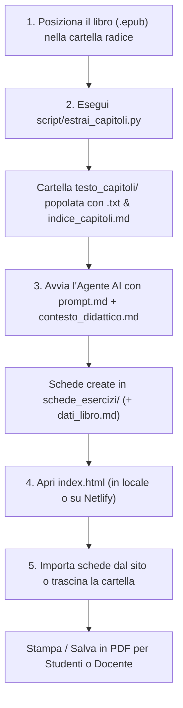

# 📚 Piattaforma Didattica Universale: Analisi Romanzo & Generatore Schede

Una piattaforma modulare, autonoma e universale ideata per docenti della **Scuola Secondaria di Primo Grado**.  
Il sistema consente di prendere un qualsiasi libro o romanzo per ragazzi in formato **EPUB**, estrarne automaticamente il testo pulito, suddividerlo pedagogicamente in blocchi narrativi coerenti, generare schede didattiche complete ad alta valenza formativa e impaginarle tramite un'**applicazione web interattiva** pronta per la stampa in PDF.

---

## 🗂️ Struttura del Progetto (Template Neutro)

Di seguito la struttura del progetto nella sua configurazione iniziale (prima dell'elaborazione di un libro):

```text
AnalisiLibro/
├── index.html                    # Applicazione web per selezione esercizi e stampa PDF (Netlify / Web / Locale)
├── style.css                     # Foglio di stile CSS (layout interfaccia, responsive mobile, tipografia, stampa A4)
├── contesto_didattico.md         # Modello pedagogico, profilo docente, criteri di ragionamento e vincoli
├── prompt.md                     # Prompt chiavi in mano da fornire all'AI per avviare l'elaborazione
├── README.md                     # Manuale operativo completo e documentazione tecnica unificata
│
├── [nome_del_libro.epub]         # 📍 QUI VA INSERITO IL FILE EPUB DEL LIBRO DA ANALIZZARE
│
├── script/                       # Moduli di automazione e codice applicativo
│   ├── app.js                    # Controller applicativo JS (parser Markdown, caricamento cartelle, anteprima e stampa)
│   └── estrai_capitoli.py        # Estrattore universale EPUB 2/3 con pulizia e de-sillabazione
│
├── testo_capitoli/               # [GENERATA] Conterrà i capitoli estratti in formato testo pulito (.txt)
│   └── indice_capitoli.md        # [GENERATO] Indice generale con conteggio parole e caratteri per capitolo
│
└── schede_esercizi/              # [GENERATA] Conterrà le schede didattiche complete in Markdown (.md)
    ├── dati_libro.md             # [GENERATO] Metadati anagrafici del romanzo (titolo, autore, anno, editore)
    ├── blocco_01_esercizi.md
    ├── blocco_02_esercizi.md
    └── ...
```

---

## 📍 Dove Posizionare il Libro da Analizzare

Il file del libro in formato **`.epub`** deve essere posizionato **nella cartella principale del progetto** (la directory radice `AnalisiLibro/`, allo stesso livello di `index.html`, `contesto_didattico.md` e `prompt.md`).

> [!TIP]
> Se nella cartella radice è presente un solo file `.epub`, gli script di estrazione lo individueranno **automaticamente**, senza bisogno di specificarne il nome o il percorso da riga di comando.

---

## ⚙️ Come Funziona l'Elaborazione: Workflow Passo dopo Passo

L'intero processo si articola in **3 passaggi sequenziali**, progettati per unire l'automazione tecnica all'intelligenza pedagogica:



---

### Passo 1: Estrazione del Testo Pulito dall'EPUB

Apri il terminale nella cartella del progetto ed esegui lo script di estrazione:

```bash
python script/estrai_capitoli.py
```

#### Caratteristiche di Universalità dello Script (`estrai_capitoli.py`)
Lo script è stato progettato per superare le consuete limitazioni dei parser rigidi e funzionare con **qualsiasi libro in formato EPUB**:

1. **Riconoscimento delle specifiche EPUB (EPUB 2 / EPUB 3):**
   - Individua dinamicamente il file descrittore `.opf` tramite il file standard `META-INF/container.xml`.
   - Supporta sia la navigazione classica basata su `toc.ncx` (EPUB 2), sia il documento di navigazione moderno `nav.xhtml` (EPUB 3).
   - In assenza di un indice esplicito, esegue un fallback intelligente sull'ordine di lettura dichiarato nello `<spine>` dell'OPF.

2. **Supporto per architetture di file diverse:**
   - **EPUB a file multipli:** libri in cui ogni capitolo è memorizzato in un file XHTML separato (es. `cap01.xhtml`, `cap02.xhtml`).
   - **EPUB monolitici o a sezioni aggregate:** libri in cui più capitoli risiedono nello stesso file XHTML suddivisi da ancore interne (`id="filepos..."` o `<a name="...">`).

3. **Pulizia e Normalizzazione Tipografica Avanzata:**
   - **Ripristino delle parole spezzate (de-sillabazione tipografica):** ricollega i lemmi spezzati a fine riga tipici delle scansioni e delle impaginazioni cartacee (es. `cop-pino` → `coppino`, `som-merso` → `sommerso`), preservando le parole composte reali e i toponimi con trattino (es. `Milano-Firenze`, `Italia-Polonia`).
   - **Eliminazione dei numeri di pagina spuri:** rimuove sia i paragrafi contenenti soli numeri di pagina isolati (es. `15`), sia i numeri rimasti incollati a fine periodo (es. `prima che 16` → `prima che`).
   - **Riconnessione dei periodi spezzati:** riunisce le frasi interrotte a cavallo di cambi pagina forzati.
   - **Rimozione di elementi di layout:** elimina tag ``, stili inline, script e artefatti grafici non testuali.

4. **Metadati e Catalogo Automatico:**
   - Estrae titolo e autore dai metadati Dublin Core dell'EPUB.
   - Salva ogni capitolo in formato `.txt` numerato in `testo_capitoli/`.
   - Genera il file `testo_capitoli/indice_capitoli.md`, che fornisce una tabella riepilogativa con il titolo di ogni capitolo, il conteggio delle parole e dei caratteri.

#### Opzioni da Riga di Comando per `estrai_capitoli.py`:
- **Auto-rilevamento (consigliato):**
  ```bash
  python script/estrai_capitoli.py
  ```
- **Specificando il file EPUB manualmente:**
  ```bash
  python script/estrai_capitoli.py "Percorso/Del/Tuo/Libro.epub"
  ```
- **Personalizzando la cartella di output:**
  ```bash
  python script/estrai_capitoli.py "Percorso/Del/Tuo/Libro.epub" -o "mia_cartella_capitoli"
  ```

---

### Passo 2: Analisi Pedagogica e Generazione Autonoma delle Schede

Fornisci all'agente AI (come Antigravity / Gemini) il prompt già pronto contenuto in [`prompt.md`](file:///c:/Ai/projects/AnalisiLibro/prompt.md).

#### Come ragiona l'Agente AI:
1. **Assimilazione del ruolo docente:** L'agente consulta [`contesto_didattico.md`](file:///c:/Ai/projects/AnalisiLibro/contesto_didattico.md), assumendo l'identità di un docente di lettere appassionato ed esperto di didattica per la scuola secondaria di primo grado (11-13 anni).
2. **Segmentazione dell'opera in blocchi narrativi:** Esamina l'indice generale dei capitoli generato e raggruppa l'intera opera in unità di lettura ideali (circa **1.500 – 3.500 parole** per blocco), garantendo la coerenza tematica ed evitando salti narrativi bruschi.
3. **Estrazione dei metadati anagrafici (`dati_libro.md`):** Crea il file `schede_esercizi/dati_libro.md` riportando titolo, autore, anno, editore e genere. Questo file funge da unica fonte di verità per le intestazioni, eliminando qualsiasi logica complessa o ambigua di parsing.
4. **Generazione autonoma delle schede:** Procede in autonomia, blocco dopo blocco, salvando i file Markdown nella cartella `schede_esercizi/` (`blocco_01_esercizi.md`, `blocco_02_esercizi.md`, ecc.).

#### Struttura Pedagogica di Ciascuna Scheda (5 Sezioni):
- **Intestazione studente:** campi Nome, Cognome, Classe, Data e citazione motivazionale dal testo.
- **Sezione 1 - Comprensione del testo:** 
  - 4-5 domande aperte a risposta argomentata (focalizzate sugli snodi narrativi e relazioni di causa-effetto).
  - 5 affermazioni Vero o Falso con rigo di correzione e motivazione obbligatoria per i falsi.
- **Sezione 2 - Analisi e riflessione:**
  - Approfondimento psicologico sui conflitti interiori e sulle scelte etiche dei personaggi.
  - Officina di scrittura creativa ed empatica in prima persona (*pagina di diario segreto, monologo interiore, lettera non spedita*).
- **Sezione 3 - Laboratorio lessicale:**
  - 5 parole d'autore ricercate o contestualizzate con tabella di abbinamento parola-significato dotata di riquadri grafici `[  ]`.
  - Sfida sul significato contestuale di espressioni idiomatiche o metafore.
- **Sezione 4 - Attività speciale «Fuori dagli schemi»:**
  - Compiti di realtà estemporanei e laboratori interdisciplinari (es. *dossier investigativi, simulazioni di processi, carte idrografiche, capsule del tempo*).
- **Sezione 5 - Guida per il docente e soluzioni:**
  - Sinossi narrativa dettagliata del blocco, obiettivi educativi (cognitivi, linguistici, relazionali), risposte modello complete per tutti i quesiti e griglia di valutazione in trentesimi.

---

### Passo 3: Selezione Esercizi e Stampa PDF con il Generatore Web (Netlify o Locale)

L'applicazione web [`index.html`](file:///c:/Ai/projects/AnalisiLibro/index.html) è un'applicazione **100% client-side**: non richiede server, database né passaggi intermedi di compilazione.

Può essere utilizzata in due modalità:
1. **Online (Netlify / Web):** Pubblicando il repository (es. su Netlify). Aprendo il sito da browser desktop o dispositivo mobile (smartphone, tablet, LIM), le schede didattiche vengono importate **automaticamente all'avvio** dalla cartella `schede_esercizi/` del repository tramite il pulsante **`⚡ Carica dal Sito`**.
2. **In locale:** Facendo doppio clic su `index.html` per aprirlo offline nel tuo browser predefinito e caricando la cartella tramite **`📁 Carica da Cartella`** o Drag & Drop.

#### Come caricare le schede:
- **Automatico Online (Netlify/Web):** Clicca su **`⚡ Carica dal Sito`** (o lascia che l'app le importi automaticamente all'apertura se non ci sono dati salvati).
- **Da Cartella Locale:** Fai clic sul pulsante **`📁 Carica da Cartella`** e seleziona `schede_esercizi/`, oppure trascina i file `.md` direttamente nella finestra.
- L'applicazione rileva all'istante `dati_libro.md`, imposta titolo e autore del romanzo, carica tutte le unità didattiche e memorizza lo stato in locale (`localStorage`).

#### Caratteristiche dell'Interfaccia Web:
1. **Scorrimento verticale indipendente:** La barra laterale sinistra (elenco delle unità didattiche) e l'area centrale di lavoro (esercizi dell'unità selezionata) scorrono verticalmente in modo completamente indipendente l'una dall'altra con barre di scorrimento sottili ed eleganti. La barra dei comandi di selezione rimane sempre visibile e ancorata in alto (*sticky*).
2. **Selezione selettiva degli esercizi:** 
   - Tutti gli esercizi (6 per ciascun blocco) sono selezionati per impostazione predefinita all'avvio.
   - Il docente può deselezionare con un semplice clic qualsiasi attività per calibrare il carico di lavoro in base al tempo a disposizione o al livello della classe.
   - Pulsanti rapidi: *Seleziona Tutto*, *Deseleziona*, *Consigliati*.
3. **Gruppo Comandi STUDENTI:**
   - **`👁️ Anteprima`:** Visualizza in finestra modale l'anteprima esatta del foglio di lavoro A4 prima di procedere alla stampa.
   - **`🖨️ Stampa PDF`:** Genera il PDF formattato per stampa A4 con intestazione alunno, citazione e righe puntinate per scrivere le risposte a mano. **Esclude rigorosamente la guida del docente e le risposte.**
4. **Gruppo Comandi DOCENTE:**
   - **`👁️ Anteprima`:** Mostra a video la sinossi narrativa, gli obiettivi didattici e il fascicolo di correzione con tutte le soluzioni.
   - **`📘 Stampa Guida`:** Stampa o salva in PDF il documento riservato all'insegnante con sinossi, risposte modello e griglia di valutazione.
5. **Formattazione tipografica avanzata del Lessico:**
   - Le tabelle del laboratorio lessicale sono regolate con larghezze rigide (`table-layout: fixed`), garantendo che la colonna delle parole (25%) e quella delle corrispondenze (16%) mantengano dimensioni ideali.
   - I riquadri di risposta `[  ]` sono protetti da ritorni a capo (`white-space: nowrap`), risultando sempre perfetti e pronti per la compilazione manuale sia a schermo sia su carta A4.

---

## 🛠️ Requisiti Tecnici

- **Python 3.7+**: Gli script fanno uso **esclusivo** della libreria standard di Python (`os`, `sys`, `json`, `glob`, `re`, `zipfile`, `xml.etree.ElementTree`, `html`). **Nessun pacchetto esterno da installare tramite `pip`.**
- **Browser:** Qualsiasi browser moderno (Google Chrome, Microsoft Edge, Mozilla Firefox, Safari).
- **Compatibilità OS:** Multipiattaforma (Windows, macOS, Linux).
