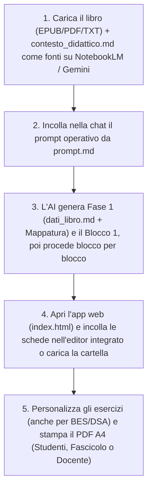

# 📚 AnalisiLibro: Piattaforma Didattica Universale & Generatore Schede

Una piattaforma modulare, autonoma e universale ideata per docenti della **Scuola Secondaria di Primo Grado** (studenti di 11-13 anni).  
Il sistema consente di analizzare qualsiasi opera letteraria o romanzo per ragazzi (in formato **EPUB**, **PDF**, **Doc** o **TXT**) tramite intelligenza artificiale (**Google NotebookLM**, **Gemini Advanced**, Claude, ChatGPT), generare schede didattiche complete ad alta valenza pedagogica e impaginarle tramite un'**applicazione web interattiva** pronta per la consultazione, la modifica live, l'adattamento **BES / DSA**, l'esportazione in **DOCX per Word / Google Documenti** e la stampa tipografica in **PDF (formato A4)**.

🌐 **Applicazione Online (GitHub Pages):** [https://aalborghetti.github.io/AnalisiLibro/](https://aalborghetti.github.io/AnalisiLibro/)

---

## 🗂️ Struttura del Progetto

Il repository si presenta come template universale e pronto all'uso, completamente client-side e privo di dipendenze esterne o runtime di backend:

```text
AnalisiLibro/
├── .github/                      # Configurazioni GitHub (CODEOWNERS, dependabot.yml, workflow Pages)
│   └── workflows/
│       └── deploy-pages.yml      # CI/CD di pubblicazione automatica su GitHub Pages
├── .gitignore                    # Regole di esclusione git (segreti, copyright epub/pdf, OS)
├── .nojekyll                     # Disabilita l'elaborazione Jekyll su GitHub Pages
├── SECURITY.md                   # Politica di sicurezza del repository
├── index.html                    # Applicazione web interattiva per selezione, editing, DOCX e stampa PDF
├── style.css                     # Foglio di stile CSS (layout responsive, modalità DSA, stampa A4)
├── app.js                        # Controller JS (parser Markdown, editor live, generatore OOXML DOCX)
├── jszip.min.js                  # Libreria client-side per impacchettamento OpenXML DOCX (zero dipendenze npm)
├── contesto_didattico.md         # Metodologia pedagogica, calibrazione quesiti e catalogo attività per l'AI
├── prompt.md                     # Comando operativo progressivo e template Markdown per il parser web
├── README.md                     # Manuale operativo e documentazione del progetto
└── schede_esercizi/              # (Opzionale) Cartella per il caricamento automatico delle schede
    ├── manifest.json             # Elenco JSON dei file presenti (es. ["dati_libro.md", "blocco_01_esercizi.md"])
    ├── dati_libro.md             # Scheda anagrafica e metadati del romanzo
    └── blocco_01_esercizi.md     # Schede didattiche dei singoli blocchi narrativi
```

> [!NOTE]
> Se pubblichi il sito su GitHub Pages o Netlify con una cartella `schede_esercizi/`, puoi includere un file `schede_esercizi/manifest.json` contenente l'array dei file (es. `["dati_libro.md", "blocco_01_esercizi.md", "blocco_02_esercizi.md"]`) per il caricamento istantaneo all'avvio. In assenza di `manifest.json`, l'app rileva automaticamente i file sequenziali `dati_libro.md`, `blocco_01_esercizi.md`, `blocco_02_esercizi.md`, interrompendo la ricerca al primo blocco non presente.

---

## ⚙️ Come Funziona il Flusso di Lavoro (100% Online)

L'intero workflow è progettato per essere eseguito **senza installare alcun software** (niente Python, Node o compilatori):



---

## 🤖 1. Generazione delle Schede con l'AI (NotebookLM / Gemini)

Il sistema separa nettamente la **metodologia pedagogica** (`contesto_didattico.md`, caricata come fonte di conoscenza) dal **comando esecutivo e sintattico** (`prompt.md`, inviato nella chat):

1. **Crea un taccuino** su [Google NotebookLM](https://notebooklm.google.com/) oppure apri una sessione su **Gemini Advanced**.
2. **Carica le Fonti:**
   - Il file del romanzo da analizzare in formato **EPUB**, **PDF**, **Doc** o **TXT**.
   - Il file [`contesto_didattico.md`](contesto_didattico.md) (trascinalo come file o incollalo come fonte).
3. **Copia e Invia il Prompt:**
   - Apri [`prompt.md`](prompt.md) (oppure clicca sul pulsante **`🤖 Prompt & Contesto`** direttamente nell'applicazione web e premi **`📋 Copia Prompt per AI`**).
   - Incolla il prompt nella chat dell'AI.
4. **Generazione Progressiva (Anti-Troncamento):**
   - **Primo passo:** L'AI genera la scheda anagrafica del libro (`dati_libro.md`), la mappatura completa delle unità didattiche e la scheda integrale del **Blocco 1**, fermandosi al termine.
   - **Passi successivi:** Invia il comando *"Procedi con il Blocco successivo"* per far generare all'AI ciascun blocco seguente uno alla volta con il massimo livello di approfondimento, evitando tagli dovuti ai limiti di lunghezza dell'output.

### 📐 Struttura Pedagogica di Ciascuna Scheda
Ciascuna unità didattica generata rispetta una precisa architettura pedagogica e tipografica:
- **Intestazione studente:** Nome, Cognome, Classe, Data e citazione motivazionale dal testo.
- **`## 1. Comprensione del Testo`:**
  - `### A. Domande a risposta aperta`: 4-5 domande non mnemoniche su cause-effetto, scelte etiche ed emozioni dei personaggi, ciascuna con righe di risposta `____`.
  - `### B. Vero o Falso?`: 5 affermazioni sottili in tabella con righe sottostanti dedicate alla correzione e motivazione dei falsi.
- **`## 2. Analisi dei Personaggi e Riflessione`:**
  - Approfondimento psicologico sui conflitti interiori, sui dilemmi etici e sull'evoluzione morale dei protagonisti.
- **`## 3. Officina di Scrittura Creativa ed Empatia`:**
  - Attività di scrittura in prima persona (*pagina di diario, monologo interiore, lettera*) con spazio di scrittura esteso.
- **`## 4. Laboratorio Lessicale e Modi di Dire`:**
  - Tabella con 5 vocaboli complessi o espressioni d'autore con caselle di abbinamento `[  ]` e definizioni contestuali sempre mescolate.
- **`## 5. Attività Speciale "Fuori dagli Schemi"`:**
  - Attività laboratoriale scelta a rotazione dal catalogo metodologico (mappa topografica, processo simulato/debate, dossier investigativo, redazione giornalistica, taccuino naturalistico/storico, simbologia) con eventuale box grafico `[SPAZIO PER IL TUO DISEGNO / RILIEVO GRAFICO]`.
- **`### GUIDA E RIASSUNTO PER IL DOCENTE`:**
  - Sinossi narrativa puntuale del blocco e chiavi di correzione complete per tutti i quesiti.

---

## 💻 2. Visualizzazione, Editing, Inclusione (DSA/BES) e Stampa Web (`index.html`)

L'applicazione web [`index.html`](index.html) è **100% client-side** (funziona sia aprendo il file localmente nel browser, sia pubblicata su Netlify, Vercel o GitHub Pages).

### Caratteristiche Principali:
1. **Caricamento Flessibile:**
   - **Da Cartella:** Clicca su **`📁 Carica Cartella Schede`** per selezionare una cartella locale contenente i file `.md`.
   - **Automatico all'avvio:** Se distribuita online con una cartella `schede_esercizi/`, l'app la rileva e carica automaticamente all'avvio.
   - **Creazione da zero:** Puoi avviare l'editor integrato anche senza file preesistenti cliccando su **`✏️ Crea da zero nell'Editor`**.

2. **Didattica Inclusiva (BES e Alta Leggibilità DSA):**
   - **`🎯 Selezione Essenziale (BES)`:** Pulsante rapido nella barra di selezione che attiva automaticamente le sole sezioni di *Comprensione*, *Vero/Falso* e *Laboratorio Lessicale* per verifiche o schede a carico cognitivo ridotto.
   - **`🔤 Alta Leggibilità (DSA)`:** Commutatore disponibile nell'anteprima di stampa che trasforma l'impaginazione secondo i criteri di alta leggibilità (font sans-serif `Plus Jakarta Sans` maggiorato a `12.5pt`, rimozione totale del corsivo, interlinea e spaziatura espanse, righe di scrittura più alte per alunni con disgrafia).

3. **Editor Markdown Integrato & Live Preview (`✏️ Modifica Markdown di questa unità`):**
   - Modifica istantaneamente qualsiasi scheda o creane di nuove direttamente dall'interfaccia.
   - Live preview affiancata con rendering tipografico A4 in tempo reale e conteggio fedele delle righe di risposta.
   - Barra di formattazione rapida per inserire tabelle Vero/Falso (complete di righe di correzione), abbinamenti lessicali `[  ]`, righe di scrittura e box di disegno.
   - Salvataggio in memoria (`localStorage`), salvataggio diretto su disco (*File System Access API*), download singolo (`⬇️ Scarica File .md`) o esportazione multipla (`📦 Scarica Tutti (.md)`).

4. **Modalità Studenti & Fascicolo Completo (Stampa PDF A4 & DOCX):**
   - **`👁️ Anteprima` / `🖨️ Stampa PDF`:** Visualizza e stampa la scheda del blocco corrente in formato A4 **escludendo rigorosamente le soluzioni e la guida docente**.
   - **`📚 Fascicolo Completo`:** Impagina tutte le unità didattiche del romanzo in un unico documento multipagina pronto per la stampa o l'esportazione.
   - **`📄 DOCX` / `📄 DOCX Fascicolo`:** Genera istantaneamente il file `.docx` per il singolo blocco o per l'intera opera.

5. **Modalità Docente:**
   - Nel riquadro verde **`DOCENTE:`**, i pulsanti **`👁️ Anteprima`**, **`📘 Stampa Guida`** e **`📄 DOCX`** generano il fascicolo riservato all'insegnante completo di sinossi narrativa, griglie e chiavi di correzione.

6. **Esportazione DOCX Nativa (Microsoft Word & Google Documenti):**
   - **100% Client-Side:** I file `.docx` (standard Microsoft Word OpenXML) vengono generati direttamente nel browser tramite [`jszip.min.js`](jszip.min.js) senza transitare su server esterni e a costo zero.
   - **Editing su Google Drive:** Basta scaricare il file `.docx`, trascinarlo sul proprio **Google Drive** e aprirlo con **Google Documenti** per editarlo, personalizzarlo, assegnarlo su **Google Classroom** o condividerlo con colleghi.
   - **Formattazione Preservata:** Tabelle Vero/Falso, caselle di abbinamento lessicale `[ ]`, righe tratteggiate di scrittura manuale e riquadri grafici vengono convertiti in elementi nativi e liberamente modificabili.

7. **Visualizzatore Prompt & Contesto Integrato:**
   - Il pulsante **`🤖 Prompt & Contesto`** nell'header consente di consultare, copiare negli appunti o scaricare in qualsiasi momento sia `prompt.md` sia `contesto_didattico.md`.

---

## 🛡️ Sicurezza & Repository Hardening

In linea con gli standard di sicurezza e qualità adottati in tutti i progetti:
- **Repository Pubblico & GitHub Pages:** Hosting statico automatico e trasparente tramite GitHub Actions, senza necessità di server o database.
- **Politica di Sicurezza ([SECURITY.md](SECURITY.md)):** Linee guida chiare per la segnalazione responsabile di eventuali anomalie tramite GitHub Security Advisories.
- **Protezione da Leak ([.gitignore](.gitignore)):** Esclusione automatica di credenziali, file d'ambiente (`.env`, `*.env`), configurazioni di editor (`.vscode/`, `.idea/`) e file editoriali protetti da copyright (`*.epub`, `*.pdf`).
- **Code Ownership ([.github/CODEOWNERS](.github/CODEOWNERS)):** Assegnazione della revisione e titolarità del codice a `@aalborghetti`.
- **Monitoraggio Automatico ([.github/dependabot.yml](.github/dependabot.yml)):** Controllo periodico automatizzato di sicurezza per GitHub Actions e dipendenze.

---

## 🛠️ Requisiti Tecnici

- **Browser:** Qualsiasi browser moderno (Google Chrome, Microsoft Edge, Mozilla Firefox, Safari).
- **Compatibilità OS:** Multipiattaforma (Windows, macOS, Linux, ChromeOS, iPadOS, Android).
- **Zero Installazioni:** Nessun server, interprete Python o pacchetto npm richiesto.