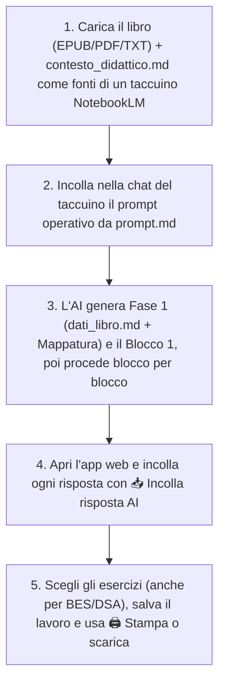

# 📚 AnalisiLibro: Piattaforma Didattica Universale & Generatore Schede

Una piattaforma modulare, autonoma e universale ideata per docenti della **Scuola Secondaria di Primo Grado** (studenti di 11-13 anni).  
Il sistema consente di analizzare qualsiasi opera letteraria o romanzo per ragazzi (in formato **EPUB**, **PDF**, **Doc** o **TXT**) tramite intelligenza artificiale (**Google NotebookLM**), generare schede didattiche complete ad alta valenza pedagogica e impaginarle tramite un'**applicazione web interattiva** pronta per la consultazione, la modifica live, l'adattamento **BES / DSA**, l'esportazione in **DOCX per Word / Google Documenti** e la stampa tipografica in **PDF (formato A4)**.

🌐 **Applicazione Online (GitHub Pages):** [https://aalborghetti.github.io/AnalisiLibro/](https://aalborghetti.github.io/AnalisiLibro/)

---

## 🗂️ Struttura del Progetto

Il repository si presenta come template universale e pronto all'uso, completamente client-side e privo di runtime di backend:

```text
AnalisiLibro/
├── .github/                      # Configurazioni GitHub (CODEOWNERS, dependabot.yml, workflow Pages)
│   └── workflows/
│       └── deploy-pages.yml      # CI/CD di pubblicazione automatica su GitHub Pages
├── .gitignore                    # Regole di esclusione git (segreti, copyright epub/pdf, OS)
├── .nojekyll                     # Disabilita l'elaborazione Jekyll su GitHub Pages
├── SECURITY.md                   # Politica di sicurezza del repository
├── index.html                    # Applicazione web interattiva per selezione, editing, DOCX e stampa PDF
├── style.css                     # Foglio di stile CSS (layout responsive, modalità DSA, stampa A4)
├── app.js                        # Controller JS (parser Markdown, editor live, generatore OOXML DOCX, salvataggi)
├── jszip.min.js                  # Libreria client-side per DOCX e file di lavoro .zip (v3.10.1, zero dipendenze npm)
├── fonts/                        # Font self-hosted (Plus Jakarta Sans, Source Serif 4) con licenze SIL OFL
├── contesto_didattico.md         # Metodologia pedagogica, calibrazione quesiti e catalogo attività per l'AI
├── prompt.md                     # Comando operativo progressivo e template Markdown per il parser web
├── GUIDA_DOCENTI.md              # Guida d'uso e domande frequenti per i docenti (mostrata dal pulsante "?")
├── README.md                     # Manuale tecnico e documentazione del progetto
├── schede/                       # Schede pronte: file di lavoro .zip elencati in «📚 I miei libri»
│   └── LEGGIMI.md                # Come pubblicare un nuovo libro nella cartella
└── schede_esercizi/              # (Opzionale) Cartella per il caricamento automatico all'avvio
    ├── manifest.json             # Elenco JSON dei file presenti (es. ["dati_libro.md", "blocco_01_esercizi.md"])
    ├── dati_libro.md             # Scheda anagrafica e metadati del romanzo
    └── blocco_01_esercizi.md     # Schede didattiche dei singoli blocchi narrativi
```

> [!NOTE]
> **Schede pronte (`schede/`):** ogni file `.zip` creato con **`💾 Salva lavoro`** e caricato nella cartella `schede/` compare in **`📚 I miei libri → Schede pronte`** e si apre con un clic. Su GitHub Pages l'elenco viene letto dall'API pubblica di GitHub (nessun file indice da aggiornare); su altri hosting si usa un file `schede/elenco.json` con i nomi degli zip. Istruzioni in [`schede/LEGGIMI.md`](schede/LEGGIMI.md).

> [!NOTE]
> **Caricamento automatico (`schede_esercizi/`):** se il sito contiene una cartella `schede_esercizi/`, l'app la carica all'avvio. Il file `schede_esercizi/manifest.json` (array dei file, es. `["dati_libro.md", "blocco_01_esercizi.md"]`, oppure `{"files": [...]}`) rende il caricamento istantaneo; in sua assenza l'app cerca i file sequenziali `dati_libro.md`, `blocco_01_esercizi.md`, `blocco_02_esercizi.md` (fino a 30 blocchi), fermandosi al primo blocco mancante. Il file di lavoro di **`💾 Salva lavoro`** contiene già la cartella `schede_esercizi/` con `manifest.json`.

---

## ⚙️ Come Funziona il Flusso di Lavoro (100% Online)

L'intero workflow è progettato per essere eseguito **senza installare alcun software** (niente Python, Node o compilatori):



---

## 🤖 1. Generazione delle Schede con l'AI (NotebookLM)

> [!TIP]
> All'apertura l'app mostra una **guida rapida in 4 passi** (riapribile in ogni momento con il pulsante **`?`**) con i link e i pulsanti per ciascun passaggio. Dalla guida si possono anche aprire le **schede pronte** pubblicate nella cartella `schede/`.

Il sistema separa nettamente la **metodologia pedagogica** (`contesto_didattico.md`, caricata come fonte di conoscenza) dal **comando esecutivo e sintattico** (`prompt.md`, inviato nella chat):

1. **Crea un taccuino** su [Google NotebookLM](https://notebooklm.google.com/) (serve un account Google).
2. **Carica le Fonti:**
   - Il file del romanzo da analizzare in formato **EPUB**, **PDF**, **Doc** o **TXT**.
   - Il file [`contesto_didattico.md`](contesto_didattico.md) (trascinalo come file o incollalo come fonte).
3. **Copia e Invia il Prompt:**
   - Apri [`prompt.md`](prompt.md) (oppure, nell'app, usa il passo 3 della guida rapida o **`🤖 Istruzioni per l'AI`** → **`📋 Copia il testo`**).
   - Incolla il prompt nella chat del taccuino.
4. **Generazione Progressiva (Anti-Troncamento):**
   - **Primo passo:** L'AI genera la scheda anagrafica del libro (`dati_libro.md`) con il Piano delle Unità Didattiche (capitoli, nucleo tematico e attività speciale assegnata a ogni blocco) e la scheda integrale del **Blocco 1**, fermandosi al termine.
   - **Passi successivi:** Invia il comando *"Procedi con il Blocco successivo"* per far generare all'AI ciascun blocco seguente uno alla volta con il massimo livello di approfondimento, evitando tagli dovuti ai limiti di lunghezza dell'output.
5. **Importazione nell'app:**
   - Ogni file prodotto dall'AI è delimitato dalle righe `[[FILE: nome.md]]` e `[[FINE]]`.
   - Copia la risposta dalla chat del taccuino, poi nell'app premi **`📥 Incolla risposta AI`** e incollala: i file `dati_libro.md` e `blocco_XX_esercizi.md` vengono separati, nominati e caricati automaticamente. Ripeti per ogni nuovo blocco.
   - Se i marcatori mancano, l'importazione divide il testo sui titoli `# Dati del Libro` e `# SCHEDA DIDATTICA`.

### 📐 Struttura Pedagogica di Ciascuna Scheda
Ciascuna unità didattica generata rispetta una precisa architettura pedagogica e tipografica:
- **Intestazione studente:** Nome, Cognome, Classe, Data e citazione motivazionale dal testo.
- **`## 1. Comprensione del Testo`:**
  - `### A. Domande a risposta aperta`: 5 domande non mnemoniche su cause-effetto, scelte etiche ed emozioni dei personaggi, ciascuna con righe di risposta `____`.
  - `### B. Vero o Falso?`: 5 affermazioni sottili in tabella con righe sottostanti dedicate alla correzione e motivazione dei falsi.
  - Nell'app le parti A e B sono due esercizi selezionabili separatamente.
- **`## 2. Analisi dei Personaggi e Riflessione`:**
  - 2 domande di approfondimento psicologico sui conflitti interiori, sui dilemmi etici e sull'evoluzione morale dei protagonisti.
- **`## 3. Officina di Scrittura Creativa ed Empatia`:**
  - Attività di scrittura in prima persona (*pagina di diario, monologo interiore, lettera*) con spazio di scrittura esteso.
- **`## 4. Laboratorio Lessicale e Modi di Dire`:**
  - Tabella con 5 vocaboli complessi o espressioni d'autore con caselle di abbinamento `[  ]` e definizioni contestuali sempre mescolate.
- **`## 5. Attività Speciale "Fuori dagli Schemi"`:**
  - Attività laboratoriale assegnata a rotazione nel Piano delle Unità Didattiche (mappa topografica, processo simulato/debate, dossier investigativo, redazione giornalistica, taccuino naturalistico/storico, simbologia): tutte le sei tipologie prima di ripeterne una, mai la stessa in due blocchi consecutivi. Eventuale box grafico `[SPAZIO PER IL TUO DISEGNO / RILIEVO GRAFICO]`.
- **`### GUIDA E RIASSUNTO PER IL DOCENTE`:**
  - Sinossi narrativa puntuale del blocco, chiavi di correzione complete per tutti i quesiti e criteri di valutazione per scrittura e attività speciale.

---

## 💻 2. Visualizzazione, Editing, Inclusione (DSA/BES) e Stampa Web (`index.html`)

L'applicazione web [`index.html`](index.html) è **100% client-side** (funziona sia aprendo il file localmente nel browser, sia pubblicata su Netlify, Vercel o GitHub Pages). L'header contiene solo sei comandi: **`📥 Incolla risposta AI`**, **`📚 I miei libri`**, **`💾 Salva lavoro`**, **`🖨️ Stampa o scarica`**, **`🤖 Istruzioni per l'AI`** e **`?`** (guida rapida).

### Caratteristiche Principali:
1. **Caricamento Flessibile:**
   - **Incolla risposta AI:** **`📥 Incolla risposta AI`** separa automaticamente i file delimitati da `[[FILE: nome.md]]` / `[[FINE]]` e li aggiunge a quelli già caricati (le schede con lo stesso nome vengono sostituite dopo conferma).
   - **I miei libri:** apre un libro salvato nel browser, una **scheda pronta** della cartella `schede/`, un file di lavoro `.zip`, singole schede `.md` o una cartella; file e cartelle si possono anche trascinare nella pagina. Se la selezione contiene file `blocco_XX…`, vengono caricati solo questi e `dati_libro.md`; in ogni caso sono ignorati `README.md`, `prompt.md`, `contesto_didattico.md` e i nomi duplicati.
   - **Automatico all'avvio:** se il sito contiene la cartella `schede_esercizi/`, l'app la carica all'avvio. Se nel browser ci sono modifiche locali non pubblicate, l'app chiede con due pulsanti espliciti quale versione usare invece di sovrascriverle.
   - **Creazione da zero:** **`✏️ Scrivi una scheda da zero`** apre l'editor con il modello standard.
   - Il titolo del libro viene letto da `dati_libro.md` o, in sua assenza, dal sottotitolo `## *Titolo* di Autore` delle schede.

2. **Non perdere il lavoro:**
   - **Salvataggio automatico nel browser** a ogni modifica, con lo stato mostrato sotto il titolo («Salvato in questo browser oggi alle 10:32» e un avviso se le ultime modifiche non sono ancora state salvate in un file).
   - **`💾 Salva lavoro`** scarica un unico file `.zip` per libro (cartella `schede_esercizi/` con `manifest.json` e, se presenti, le versioni salvate in `versioni.json`), da riaprire con **`📚 I miei libri`** o trascinandolo nella pagina.
   - **`📚 I miei libri`** conserva più libri nel browser (IndexedDB): si passa da un libro all'altro senza perdere nulla e si eliminano quelli non più necessari.

3. **Didattica Inclusiva (BES e Alta Leggibilità DSA):**
   - **`🎯 Selezione Essenziale (BES)`:** Pulsante rapido nella barra di selezione che attiva automaticamente le sole sezioni di *Comprensione (domande aperte)*, *Vero/Falso* e *Laboratorio Lessicale* per verifiche o schede a carico cognitivo ridotto. Ogni esercizio resta poi selezionabile o deselezionabile singolarmente.
   - **`📌 Versioni salvate`:** le scelte degli esercizi di tutti i blocchi si salvano con un nome (es. «2B completa», «Versione BES») e si richiamano dal menu *Versione*; sono incluse nel file di **`💾 Salva lavoro`**.
   - **`🔤 Alta Leggibilità (DSA)`:** casella della finestra **`🖨️ Stampa o scarica`** (e pulsante nell'anteprima) che trasforma l'impaginazione secondo i criteri di alta leggibilità (font sans-serif `Plus Jakarta Sans` maggiorato a `12.5pt`, rimozione totale del corsivo, interlinea e spaziatura espanse, righe di scrittura più alte per alunni con disgrafia). Vale sia per stampa/PDF sia per Word (Verdana 12,5 pt, senza corsivi, interlinea 1,5) e viene ricordata tra una sessione e l'altra.

4. **Editor con anteprima (`✏️ Modifica il testo di questa scheda`):**
   - Modifica qualsiasi scheda o creane di nuove (**`➕ Nuova scheda…`**, indicando solo il numero del blocco).
   - Anteprima affiancata con rendering tipografico A4 in tempo reale e conteggio fedele delle righe di risposta.
   - Barra di formattazione rapida per inserire titoli, tabelle Vero/Falso, abbinamenti lessicali `[  ]`, righe di scrittura e box di disegno.
   - **`✅ Salva modifiche`** (Ctrl+S), **`⬇️ Scarica questa scheda`** e **`↩️ Annulla tutte le modifiche`**; chiudendo o cambiando scheda con modifiche in sospeso l'app chiede se salvarle.
   - Le selezioni degli esercizi vengono conservate quando si salvano modifiche; gli esercizi nuovi risultano selezionati.

5. **Stampa o scarica (`🖨️ Stampa o scarica`):** un'unica finestra con tre scelte e un riepilogo di ciò che verrà prodotto:
   - **Che cosa:** l'unità corrente oppure tutto il libro (ogni unità su una nuova pagina; le unità senza esercizi scelti o senza guida vengono saltate).
   - **Per chi:** studenti (solo esercizi scelti, **mai soluzioni o guida docente**) oppure docente (sinossi e chiavi di correzione).
   - **Formato:** stampa/PDF A4, con il suggerimento di scegliere «Salva come PDF» e disattivare intestazioni e piè di pagina, oppure Word / Google Documenti (`.docx`).
   - **`👁️ Anteprima`** mostra il documento prima di stamparlo o scaricarlo.

6. **Esportazione DOCX Nativa (Microsoft Word & Google Documenti):**
   - **100% Client-Side:** I file `.docx` (standard Microsoft Word OpenXML) vengono generati direttamente nel browser tramite [`jszip.min.js`](jszip.min.js) senza transitare su server esterni e a costo zero.
   - **Editing su Google Drive:** Basta scaricare il file `.docx`, trascinarlo sul proprio **Google Drive** e aprirlo con **Google Documenti** per editarlo, personalizzarlo, assegnarlo su **Google Classroom** o condividerlo con colleghi.
   - **Formattazione Preservata:** Tabelle Vero/Falso e di abbinamento diventano tabelle Word con colonne proporzionate, le righe di scrittura diventano paragrafi con bordo tratteggiato e gli spazi per il disegno diventano riquadri: tutto resta liberamente modificabile. Le caselle `[ ]` restano caratteri di testo.

7. **Istruzioni per l'AI e aiuto:**
   - **`🤖 Istruzioni per l'AI`** consente di consultare, copiare o scaricare le istruzioni (`prompt.md`) e le linee guida didattiche (`contesto_didattico.md`).
   - Il pulsante **`?`** riapre la guida rapida; da lì **`📖 Guida e domande frequenti`** mostra [`GUIDA_DOCENTI.md`](GUIDA_DOCENTI.md) (con il manuale tecnico in una seconda scheda).
   - Le conferme usano finestre dell'app con pulsanti che dicono esattamente cosa succede (es. «Salva ed esci» / «Esci senza salvare»); avvisi ed errori importanti restano visibili finché non vengono chiusi.

---

## 🛡️ Sicurezza & Repository Hardening

In linea con gli standard di sicurezza e qualità adottati in tutti i progetti:
- **Repository Pubblico & GitHub Pages:** Hosting statico automatico e trasparente tramite GitHub Actions, senza necessità di server o database.
- **Politica di Sicurezza ([SECURITY.md](SECURITY.md)):** Linee guida chiare per la segnalazione responsabile di eventuali anomalie tramite GitHub Security Advisories.
- **Protezione da Leak ([.gitignore](.gitignore)):** Esclusione automatica di credenziali, file d'ambiente (`.env`, `*.env`), configurazioni di editor (`.vscode/`, `.idea/`) e file editoriali protetti da copyright (`*.epub`, `*.pdf`).
- **Code Ownership ([.github/CODEOWNERS](.github/CODEOWNERS)):** Assegnazione della revisione e titolarità del codice a `@aalborghetti`.
- **Monitoraggio Automatico ([.github/dependabot.yml](.github/dependabot.yml)):** Controllo periodico automatizzato delle versioni delle GitHub Actions. La libreria `jszip.min.js` (v3.10.1) è inclusa direttamente nel repository e non è coperta da Dependabot: va aggiornata manualmente.
- **Nessuna risorsa esterna all'avvio:** I font sono ospitati nella cartella `fonts/` (licenza SIL OFL), quindi aprendo l'app non viene contattato alcun server di terze parti (nessun trasferimento dell'indirizzo IP a Google Fonts, rilevante per il GDPR in ambito scolastico). L'unica richiesta esterna è all'API pubblica di GitHub (`api.github.com`), solo quando si apre **`📚 I miei libri`** sul sito GitHub Pages, per elencare le schede pronte della cartella `schede/`.
- **Dati nel browser:** libri, versioni e preferenze restano nel browser del docente (localStorage e IndexedDB) e non vengono inviati a nessun server.
- **Sanitizzazione dei contenuti:** L'HTML generato dai file Markdown (anche se prodotti da un'AI o ricevuti da terzi) viene ripulito da script, gestori di eventi e link `javascript:` prima di essere mostrato.

---

## 🛠️ Requisiti Tecnici

- **Browser:** Qualsiasi browser moderno (Google Chrome, Microsoft Edge, Mozilla Firefox, Safari).
- **Compatibilità OS:** Multipiattaforma (Windows, macOS, Linux, ChromeOS, iPadOS, Android).
- **Zero Installazioni:** Nessun server, interprete Python o pacchetto npm richiesto.