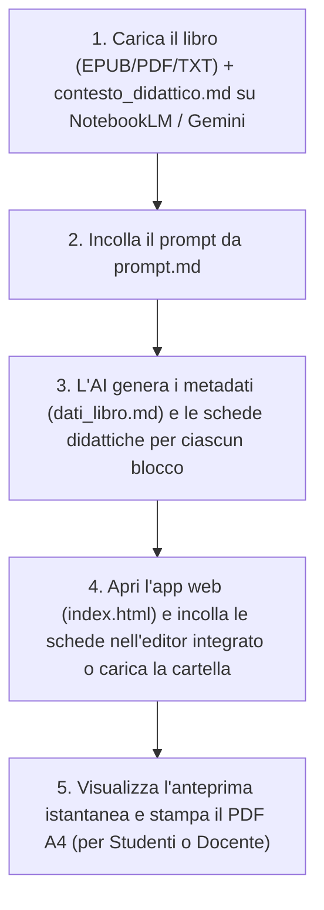

# 📚 AnalisiLibro: Piattaforma Didattica Universale & Generatore Schede

Una piattaforma modulare, autonoma e universale ideata per docenti della **Scuola Secondaria di Primo Grado** (studenti di 11-13 anni).  
Il sistema consente di analizzare qualsiasi opera letteraria o romanzo per ragazzi (in formato **EPUB**, **PDF**, **Doc** o **TXT**) tramite intelligenza artificiale (**Google NotebookLM**, **Gemini Advanced**, Claude, ChatGPT), generare schede didattiche complete ad alta valenza pedagogica e impaginarle tramite un'**applicazione web interattiva** pronta per la consultazione, la modifica live e la stampa tipografica in PDF (formato A4).

---

## 🗂️ Struttura del Progetto

Il repository si presenta come template universale e pronto all'uso, completamente client-side e privo di dipendenze esterne:

```text
AnalisiLibro/
├── .github/                      # Configurazioni GitHub (CODEOWNERS, dependabot.yml)
├── .gitignore                    # Regole di esclusione git (segreti, copyright epub/pdf, OS)
├── SECURITY.md                   # Politica di sicurezza del repository
├── index.html                    # Applicazione web interattiva per selezione, editing e stampa PDF
├── style.css                     # Foglio di stile CSS (layout responsive, tipografia, stampa A4)
├── app.js                        # Controller applicativo JS (parser Markdown, editor live, storage)
├── contesto_didattico.md         # Modello pedagogico, profilo docente e criteri metodologici per l'AI
├── prompt.md                     # Prompt operativo "chiavi in mano" da fornire all'AI
└── README.md                     # Manuale operativo e documentazione del progetto
```

> [!NOTE]
> Quando generi le schede con l'AI o salvi i blocchi dall'editor web, puoi organizzarli opzionalmente nella cartella `schede_esercizi/` (`dati_libro.md`, `blocco_01_esercizi.md`, ecc.), oppure caricarli e gestirli direttamente dall'interfaccia del browser.

---

## ⚙️ Come Funziona il Flusso di Lavoro (100% Online)

L'intero workflow è progettato per essere eseguito **senza installare alcun software** (niente Python, Node o compilatori):



---

## 🤖 1. Generazione delle Schede con l'AI (NotebookLM / Gemini)

1. **Crea un taccuino** su [Google NotebookLM](https://notebooklm.google.com/) oppure apri una sessione su **Gemini Advanced**.
2. **Carica le Fonti:**
   - Il file del romanzo da analizzare in formato **EPUB**, **PDF**, **Doc** o **TXT**.
   - Il file [`contesto_didattico.md`](contesto_didattico.md) (trascinalo come file o incollalo come nota).
3. **Copia e Invia il Prompt:**
   - Apri [`prompt.md`](prompt.md) (oppure clicca sul pulsante **`🤖 Prompt & Contesto`** direttamente nell'applicazione web e premi **`📋 Copia Prompt per AI`**).
   - Incolla il prompt nella chat dell'AI.
4. **L'AI genera il materiale didattico in due fasi:**
   - **Fase 1 (Metadati & Mappatura):** Genera la scheda anagrafica del libro (`dati_libro.md`) e suddivide l'intera opera in unità didattiche equilibrate (circa 1.500 - 3.500 parole o 2-4 capitoli per blocco).
   - **Fase 2 (Schede Didattiche):** Produce blocco dopo blocco le schede complete in formato Markdown standard.

### 📐 Struttura Pedagogica di Ciascuna Scheda (5 Sezioni)
Ciascuna unità didattica generata rispetta una precisa architettura pedagogica:
- **Intestazione studente:** Nome, Cognome, Classe, Data e citazione motivazionale dal testo.
- **Sezione 1 - Comprensione del testo:** 
  - 4-5 domande aperte non mnemoniche su cause-effetto, scelte etiche ed emozioni dei personaggi, con righe di risposta `____`.
  - 5 affermazioni Vero o Falso con rigo di correzione e motivazione obbligatoria per i falsi.
- **Sezione 2 - Analisi e riflessione:**
  - Approfondimento psicologico sui conflitti interiori e sull'evoluzione morale dei protagonisti.
  - Officina di scrittura creativa ed empatica in prima persona (*pagina di diario, monologo, lettera*).
- **Sezione 3 - Laboratorio lessicale:**
  - Tabella con 5 vocaboli complessi o espressioni idiomatiche d'autore con caselle di abbinamento `[  ]`.
- **Sezione 4 - Attività speciale «Fuori dagli schemi»:**
  - Compito di realtà, mappe visive, laboratori interdisciplinari o box grafico `[SPAZIO PER IL TUO DISEGNO / RILIEVO GRAFICO]`.
- **Sezione 5 - Guida per il docente e soluzioni:**
  - Sinossi narrativa puntuale del blocco, obiettivi educativi e chiavi di correzione complete per tutti i quesiti.

---

## 💻 2. Visualizzazione, Editing e Stampa Web (`index.html`)

L'applicazione web [`index.html`](index.html) è un'applicazione **100% client-side** (funziona sia aprendo il file localmente nel browser, sia pubblicata su Netlify, Vercel o GitHub Pages).

### Caratteristiche Principali:
1. **Caricamento Flessibile:**
   - **Da Cartella:** Clicca su **`📁 Carica Cartella Schede`** per selezionare una cartella locale contenente i file `.md`.
   - **Automatico all'avvio:** Se distribuita online con una cartella `schede_esercizi/`, l'app la rileva e carica automaticamente all'avvio.
   - **Nessun file presente?** L'interfaccia si avvia in uno stato pulito e accogliente con editor integrato.

2. **Editor Markdown Integrato & Live Preview (`✏️ Modifica .MD`):**
   - Modifica istantaneamente qualsiasi scheda o creane di nuove direttamente dall'interfaccia.
   - Live preview affiancata con rendering tipografico A4 in tempo reale.
   - Barra di formattazione rapida per inserire tabelle Vero/Falso, abbinamenti lessicali `[  ]`, righe di scrittura e box di disegno.
   - Salvataggio locale in memoria (`localStorage`), salvataggio su disco con *File System Access API* o download del file `.md`.

3. **Modalità Studenti (Stampa PDF A4):**
   - **`👁️ Anteprima`:** Visualizza la scheda studente esattamente come apparirà stampata.
   - **`🖨️ Stampa PDF`:** Genera il PDF formattato per fogli A4 con righe puntinate per la compilazione manuale, **escludendo rigorosamente le soluzioni e la guida docente**.

4. **Modalità Docente:**
   - **`👁️ Anteprima Docente`:** Mostra a video o in stampa il fascicolo completo con sinossi, obiettivi didattici e tutte le risposte modello.

5. **Visualizzatore Prompt & Contesto Integrato:**
   - Il pulsante **`🤖 Prompt & Contesto`** nell'header consente di visualizzare e copiare in qualsiasi momento il prompt operativo e la guida pedagogica senza dover aprire file esterni.

---

## 🛡️ Sicurezza & Repository Hardening

In linea con gli standard di sicurezza adottati in tutti i progetti:
- **Repository Privato:** Protezione del codice sorgente e del materiale didattico.
- **Politica di Sicurezza ([SECURITY.md](SECURITY.md)):** Linee guida chiare per la segnalazione responsabile di eventuali anomalie tramite GitHub Security Advisories.
- **Protezione da Leak ([.gitignore](.gitignore)):** Esclusione automatica di credenziali, file d'ambiente (`.env`, `*.env`), configurazioni di editor (`.vscode/`, `.idea/`) e file editoriali protetti da copyright (`*.epub`, `*.pdf`).
- **Code Ownership ([.github/CODEOWNERS](.github/CODEOWNERS)):** Assegnazione della revisione e titolarità del codice a `@aalborghetti`.
- **Monitoraggio Automatico ([.github/dependabot.yml](.github/dependabot.yml)):** Controllo periodico automatizzato di sicurezza per GitHub Actions e dipendenze.
- **GitHub Security Alerts:** Dependabot Vulnerability Alerts e Automated Security Fixes attivi.

---

## 🛠️ Requisiti Tecnici

- **Browser:** Qualsiasi browser moderno (Google Chrome, Microsoft Edge, Mozilla Firefox, Safari).
- **Compatibilità OS:** Multipiattaforma (Windows, macOS, Linux, ChromeOS, iPadOS, Android).
- **Zero Installazioni:** Nessun server, interprete Python o pacchetto npm richiesto.
